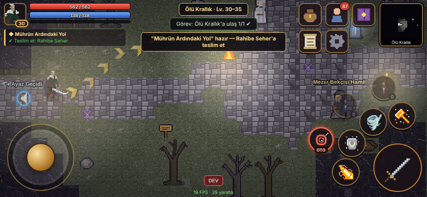
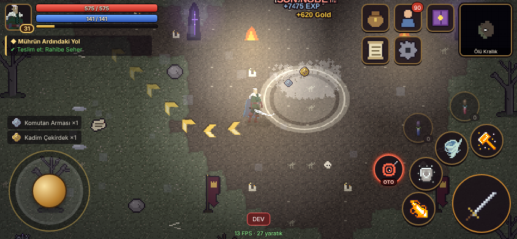
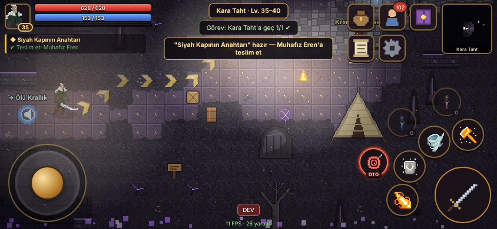
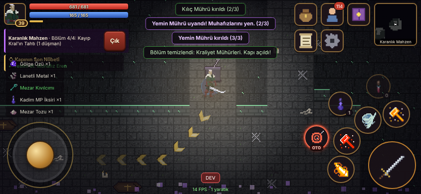
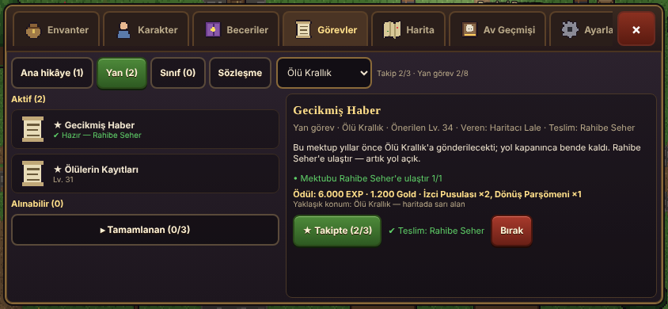
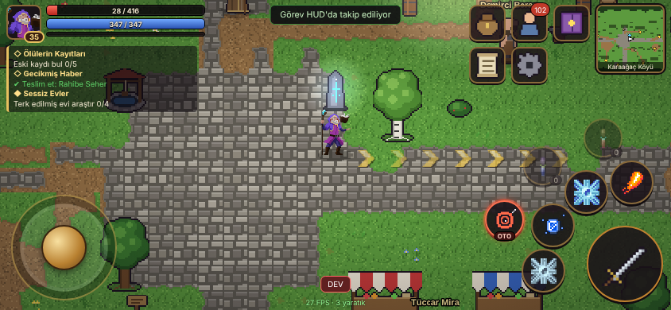

# AHEN VADİSİ — V4.0 «Gökyarık Genişlemesi» (4.0.1)

Mobil öncelikli (yatay ekran), HTML5 tabanlı, eski usul 2D fantastik RPG. Karaağaç Köyü'nden Derin Ocak'a uzanan
Lv. 1–20 ilerleme döngüsü (V1), **V2.0 Kül ve Ayaz (Lv. 21–30)** ve onların üzerine kurulan **V3.0 Kayıp Krallığın
Mirası (Lv. 31–40)** ve **V4.0 Gökyarık Genişlemesi (Lv. 41–50)**: Kara Taht'ın kuzeyinde göğe açılan yarıktan Gökyarık
Ovası'na, Yıldız Mezarı'na ve Gökyarık Mabedi'nde zincirlenmiş Göğün Mahkûmu'na uzanan hikâye. Savaşçı, Büyücü, **Okçu** veya
**Ölü Çağıran** ile seviye kas, nadir eşya düşür, demircide +5'e kadar yükselt, Alfa Kurt'tan Göğün Mahkûmu'na sekiz bossu yen,
zindanlara sınırsız gir ve Legendary avına çık.

V1, V2 ve V3 kayıtları V4'te otomatik ve kayıpsız açılır (geçişten önceki kayıt `v1_backup` / `v2_backup` / `v3_backup`
olarak saklanır; 3 yuva 5'e genişler). Değişiklikler: [`docs/CHANGELOG.md`](docs/CHANGELOG.md) · V4 mimarisi, denge ve
bilinen sınırlamalar: [`docs/V4_NOTLARI.md`](docs/V4_NOTLARI.md) · V3: [`docs/V3_NOTLARI.md`](docs/V3_NOTLARI.md) ·
V2: [`docs/V2_NOTLARI.md`](docs/V2_NOTLARI.md)

Dört oyuncu sınıfı (Savaşçı, Büyücü, Okçu: Huntress 2, Ölü Çağıran: Evil Wizard 3; iskeletleri: Skeleton Sprite Pack) ve V1 yaratıklarının çoğu hazır sprite paketleriyle çizilir (V2–V4 yaratıkları procedural)
(`public/sprites/`, kaynaklar: [`docs/CREDITS.md`](docs/CREDITS.md)). Diğer tüm görseller (Kızıl Akrep dışındaki V2 yaratık/elit/boss
sprite'ları, NPC'ler, kül/kar/buz tile set'leri, efektler) ve bütün sesler **oyun açılırken kodla (procedural) üretilir**.
Eşya, materyal ve beceri ikonlarının çoğu Clockwork Raven Studios ikon paketlerinden alınır (`src/art/iconPack.js`).
Ayarlar → "Kahraman görünümü: Ekipman görünür (piksel)" seçeneği giyilen silah/zırhı gösteren piksel kahramanı kullanır.
Sprite paketi yüklenemezse oyun otomatik olarak procedural karaktere geri döner.

## Ekran görüntüleri

| | |
|---|---|
|  |  |
|  |  |
|  |  |
|  |  |
|  |  |
|  |  |
|  |  |
|  |  |
|  |  |

## Hızlı başlangıç

Gereksinim: Node.js 20.19+ (veya 22.12+).

```bash
cd ahen-vadisi
npm install          # bağımlılıklar (Phaser 3.90, Vite, Vitest, Playwright)
npm run dev          # geliştirme sunucusu: http://localhost:5173  (aynı ağdaki telefondan: http://<bilgisayar-ip>:5173)
npm test             # birim testleri (V1+V2+V3; 100.000–1.000.000 loot simülasyonu ve V3 denge simülasyonu dahil)
npm run build        # üretim paketi → dist/
npm run preview      # dist/ klasörünü yerelde sun: http://localhost:4173
npm run test:e2e     # (önce build) tarayıcıda uçtan uca testler — V1 + V2 regresyonu + V3 senaryoları
npm run package      # release/ altında itch.io ZIP'i ve proje arşivi
```

Geliştirici paneli yalnızca adres çubuğuna `?dev=1` eklenince görünür (ör. `http://localhost:5173/?dev=1`).
Normal oyuncu deneyiminde hiçbir hile/test butonu yoktur.

## Hazır HTML5 paketi (itch.io / statik sunucu)

`npm run build` sonrası `dist/` klasörü tek başına çalışır:

- `index.html` kökte, tüm dosyalara **göreli yollarla** erişir (`base: './'`).
- Ek sunucu veya backend gerekmez; kayıt tarayıcıda IndexedDB'de tutulur.
- `sw.js` servis işçisi tüm dosyaları önbelleğe alır → HTTPS veya localhost üzerinde **çevrimdışı oynanır**.
- `manifest.webmanifest` ile Android'de "Ana ekrana ekle" → tam ekran yatay PWA.

### itch.io'ya yükleme

1. `npm run package` → `release/ahen-vadisi-html5-itch.zip` oluşur (içinde kökte `index.html`).
2. itch.io → *Create new project* → **Kind of project: HTML**.
3. ZIP'i yükle, **"This file will be played in the browser"** kutusunu işaretle.
4. *Embed options*: **Mobile friendly** ✔, **Orientation: Landscape**, *Viewport dimensions* 960×540,
   **Fullscreen button** ✔ (önerilir), *Automatically start on page load* isteğe bağlı.
5. Kaydet ve önizle. (itch.io iframe'inde servis işçisi tarayıcıya göre çalışmayabilir; oyun yine de çalışır.)

### GitHub Pages

Bu depoda `ahen-vadisi/dist/` derlenmiş haliyle bulunur. Dal `main`'e birleştirildiğinde oyun
`https://aygforge.github.io/ahen-vadisi/dist/` adresinden oynanabilir (HTTPS → PWA/çevrimdışı destekli).

## Kontroller

| Dokunmatik (birincil) | Klavye (masaüstü) |
|---|---|
| Sol alt joystick: hareket (en yüksek öncelik, otomatik yaklaşmayı anında keser); halkanın çevresine dokunmak da yönlendirir | WASD / oklar |
| Düşmana dokun: hedef seç → yol bularak yaklaş → menzilde otomatik normal saldırı | — |
| NPC / cevher / bitki / görev nesnesine dokun: yaklaş ve etkileşim | — |
| Büyük kılıç: aktif saldırı — her basış en yakın düşmana bir vuruş, basılı tutunca vurmaya devam | Boşluk |
| Küçük kırmızı "OTO" butonu: otomatik normal saldırı aç/kapa | R |
| Sağ alt 4 beceri butonu (manuel; hangi 4 aktif becerinin duracağı Beceriler ekranında seçilir) | 1–4 |
| HP / MP iksir butonları; hedef değiştir (klavye) | Q / E, Tab |
| Sağ üst: Çanta, Karakter, Beceriler, Görevler, Ayarlar, mini harita | I, C, K, J, Esc, M |

Zemindeki altın oklar takip edilen görevin bir sonraki hedefine (başka haritadaysa oraya götüren geçide) giden
yolu gösterir; Ayarlar → "Görev yön okları" ile kapatılabilir. Harita geçişleri geçidin tamamından yapılır.

Kurallar (belge §3.1): joystick bırakılınca karakter hedefe kendiliğinden koşmaz; hedef ölünce yeni hedef
otomatik seçilmez; erişilemeyen hedefe sonsuz koşma olmaz; duvar arkasından saldırı yapılamaz.

## İçerik özeti

- **Sınıflar:** Savaşçı, Büyücü, Okçu (menzilli fiziksel, duvara çarpan oklar), Ölü Çağıran (MP'siz Ruh Mermisi, en çok 2
  iskelet; iskelet yalnız seçili hedefe saldırır) — her biri 7 aktif (Lv.1/5/10/15/25/35/45), 3 pasif, Ustalık I (Lv.20),
  II (Lv.40), III (Lv.50), 4 düğmelik beceri çubuğu, Lv.30 Ustalık Kitapları; Lv.50'de 147 stat puanı.
- **Dünya:** Karaağaç Köyü (64×48), Fısıldayan Orman (120×88), Kırık Damar Madeni (104×78), Sis Bataklığı (112×80),
  Derin Ocak dungeon'ı (104×80, 4 bölüm); **V2:** Kül Yaylaları (112×80, Lv.20–25), Ayaz Geçidi (116×88, Lv.25–30),
  Buz Mabedi dungeon'ı (100×76, 4 bölüm, Mühür Galerisi); **V3:** Ölü Krallık (120×88, Lv.30–35), Kara Taht (124×92, Lv.35–40),
  Karanlık Mahzen dungeon'ı (100×76, 4 bölüm: kapı mekanizmaları + kraliyet mühürleri); **V4:** Gökyarık Ovası (124×88,
  Lv.40–45), Yıldız Mezarı (128×92, Lv.45–50), Gökyarık Mabedi dungeon'ı (112×80, 5 bölüm: kapı mührü, enerji düğümleri,
  koridorlar, savunmalı gök mühürleri, Göğün Mahkûmu). Her açık bölgede 4 farm kampı, elit,
  yol taşı, toplama düğümleri; V2/V3 bölgelerinde güvenli kamp, NPC'ler, 2'şer gizli sandık.
- **Yaratıklar:** 36 normal, 9 elit, 8 boss (Alfa Kurt, Maden Golemi, Kül Devi, Donmuş Muhafız, Mezar Komutanı, Kayıp Kral,
  Fırtına Tiranı, Göğün Mahkûmu) —
  telegraflı büyük saldırılar, aşamalar, kalkanlar ve kırılabilir mühürler, yer tehlikeleri, yardımcı çağırma, lanet.
- **Eşyalar:** 210 ekipman şablonu (V1 60, V2 30, V3 36, V4 84), rastgele bonuslar, +5 yükseltme (başarısızlıkta eşya kırılmaz).
- **Hardcore loot:** Legendary yalnızca Maden Golemi, Donmuş Muhafız, Kayıp Kral ve Göğün Mahkûmu'nun %0,4 boss çekilişinden
  (%80 kendi sınıfı);
  pity/garanti/craft/sandık/görev yok.
- **Ekonomi:** Tek para Gold; 12 iksir, 8 kullanım eşyası, üretim (demirci, şifacı, simya), tamir, parçalama,
  çanta/depo genişletme, ortak depo, yol taşı seyahati.
- **Görevler:** 102 tek seferlik ana/yan görev (refakat, savunma, iz sürme, üretim, onarım/arındırma, özel av), 10 sınıf görevi
  (+4 yeni sınıf rehber görevi),
  tekrarlanabilir Av Sözleşmeleri; görev günlüğünde kategori/bölge filtresi ve 3 görev takibi.
- **Av Geçmişi:** türe göre öldürme, boss zaferleri, bulunan Rare/Epic/Legendary, tamamlanan zindanlar (ganimeti etkilemez).
- **Kayıt:** 5 karakter yuvası, Ayarlar → Kayıt Güvenliği (son kalıcı kayıt, teknoloji, yedekler, kurtarma), IndexedDB + localStorage aynası (çift yazım), önceki sağlam kayıtlar + kayıt geçmişi, checksum,
  bozuk kayıt onarımı, kayıp karakter kurtarma, yedek kodu (kopyala/yapıştır) ve JSON yedek dışa/içe aktarma,
  sürümlü şema geçişi (V1 → V2 → V3 → V4) ve geçiş öncesi yedek; depolama açılamazsa kayıt üzerine boş profil yazılmaz. PWA: yeni sürüm hazır olunca "kaydet ve yenile" bildirimi.

## Proje yapısı

```
ahen-vadisi/
├─ index.html              giriş sayfası (viewport-fit=cover, dikey ekran uyarısı)
├─ public/                 manifest, uygulama ikonları
├─ src/
│  ├─ main.js              önyükleme, Phaser yapılandırması, yaşam döngüsü (arka plan kaydı)
│  ├─ core/                app (profil, kayıt zamanlaması, stat önbelleği), olay yolu, RNG
│  ├─ data/                MERKEZİ VERİ: sabitler, sınıflar, beceriler, yaratıklar, 210 eşya, materyaller,
│  │                       tarifler, loot oranları, NPC'ler, görevler, 14 harita tanımı
│  ├─ systems/             SAF OYUN MANTIĞI (Node'da test edilir): stats, combat, loot, inventory,
│  │                       economy (alım/satım/craft/yükseltme/tamir), quests, rewards, dungeon, character
│  ├─ save/                şema/doğrulama/checksum + IndexedDB deposu (snapshot, localStorage yedeği)
│  ├─ world/               harita üreticisi, tile kaydı, ızgara (çarpışma, görüş, A*), savaş çalışma zamanı,
│  │                       spawner, efektler, keşif (fog), girdi
│  ├─ entities/            Player (B kontrolü), Enemy (AI), bosslar, etkileşim nesneleri
│  ├─ scenes/              BootScene (doku üretimi), WorldScene, doku kaydı
│  ├─ art/                 procedural pixel-art: pixel tamponu, tile/damga, karakter, yaratık, ikon, efekt, menü manzarası
│  ├─ audio/               WebAudio procedural ses efektleri, ortam ve müzik
│  ├─ ui/                  DOM arayüz: HUD, joystick, menüler, paneller (envanter, karakter, beceri, görev,
│  │                       harita, ayarlar, NPC hizmetleri), eşya kartı/karşılaştırma
│  └─ dev/                 geliştirici paneli (?dev=1)
├─ tests/unit/             Vitest: veri, harita, formüller, loot RNG, ekonomi, görevler, dungeon, kayıt, denge
├─ tests/e2e/              Playwright: mobil HUD (5 çözünürlük), kontrol, kayıt, PWA, performans, dungeon
├─ tools/                  ikon üretici, paketleyici, görsel inceleme betikleri
└─ docs/                   TEST_RAPORU.md, GELISTIRME_NOTLARI.md
```

Tasarım ilkesi: hasar, loot, görev, eşya ve ekonomi işlemleri **tek yetkili sistem** (`src/systems/*`) tarafından
hesaplanır; arayüz yalnızca bu sistemlerin sonucunu gösterir (`src/ui/actions.js` köprüsü).

Ayrıntılı test sonuçları: [`docs/TEST_RAPORU.md`](docs/TEST_RAPORU.md) ·
Genişletme rehberi: [`docs/GELISTIRME_NOTLARI.md`](docs/GELISTIRME_NOTLARI.md)
