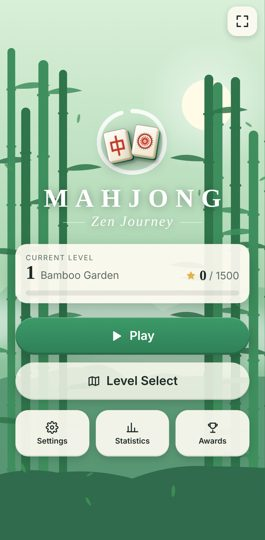
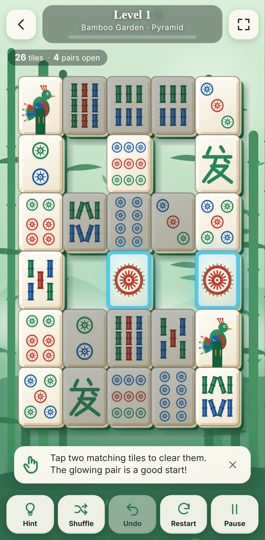
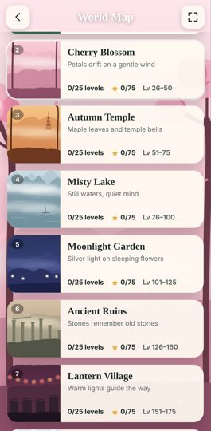
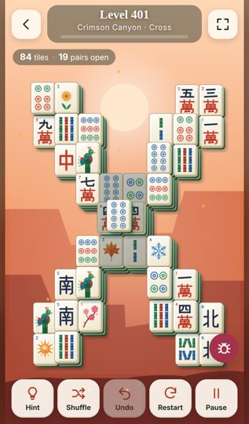
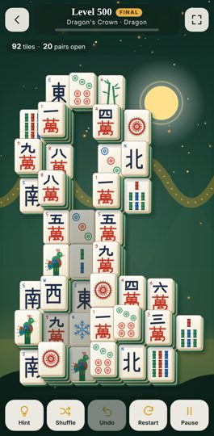

# Mahjong: Zen Journey

A calm, portrait-first Mahjong Solitaire game: **500 verified levels across 20 themed worlds**, built with HTML5, CSS3 and vanilla JavaScript. Everything is in one offline `index.html` (about 330 KB): the tile art, backgrounds, synthesized audio and all level data. It needs no CDN, fonts, images, audio files or network access.

| Menu | Level 1 (tutorial) | World map | Level 401 | Level 500 |
|---|---|---|---|---|
|  |  |  |  |  |

## Running the game

- **Play locally:** open `index.html` in any modern browser. Double-clicking it (`file://`) works.
- **GitHub Pages:** this folder is served at `https://aygforge.github.io/mahjong-zen-journey/`.
- **itch.io:** upload `dist/mahjong-zen-journey-itch.zip` (it contains only `index.html`).

### Recommended itch.io settings

| Setting | Value |
|---|---|
| Kind of project | HTML |
| Embed / viewport | 405 × 720 (or "Fit to screen" if available) |
| Mobile Friendly | **Enabled** |
| Orientation | **Portrait** |
| Launch mode on mobile | **Click to launch in fullscreen** (preferred) |
| Fullscreen button | **Enabled** |
| Scrollbars | **Disabled** |

The game has its own fullscreen button, separate from itch.io's. If the embedding iframe does not allow fullscreen, the game says so and offers **Open in new tab**. It never pretends fullscreen worked.

## Mobile use

- The game is designed for 9:16 portrait and adapts to taller phones (19.5:9, 20:9). It fills the viewport using `100dvh`/`100vh`, `viewport-fit=cover` and safe-area insets, so the notch and home bar never cover buttons.
- On a phone held in landscape, a "please rotate" screen appears and the timer pauses. On desktop the game shows as a centred portrait column, with a blurred copy of the world background filling the sides.
- **Fullscreen** (button at the top right of the menu and game screens) uses the real Fullscreen API, with `webkit`-prefixed fallbacks, and tries to lock portrait orientation. Safari on iPhone has no element fullscreen. There the button explains this and suggests *Add to Home Screen*.
- **Controls:**
  - **Tap a tile:** select it.
  - **Pinch** (or mouse wheel): zoom.
  - **Drag while zoomed:** pan.
  - **Fit:** reset the zoom.
  - **Keyboard:** `H` hint, `S` shuffle, `U` or `Ctrl+Z` undo, `P`/`Esc` pause, `F` fullscreen.
- Hit-testing follows the visual stacking order, so a covered tile can never be picked through the tile above it.

## Rules

- Match two identical **free** tiles. A tile is free when no tile covers any part of it and its left or right side is open.
- **Flowers** match any Flower and **Seasons** match any Season. They appear from World 2, with a one-time tip.
- There is no time limit (time is only a statistic). Undo is unlimited and never costs stars.
- **Stars:**
  - 3★: no hint or shuffle used.
  - 2★: at most 2 hints, or 1 shuffle.
  - 1★: more help than that.
  - Each level keeps its best result. Stars never gate progress: clearing level *n* unlocks *n+1*.
- **Hint** shows a pair taken from a full solution of the current board whenever the solver finds one, so following hints never leads into a dead end.
- **Shuffle** re-deals the remaining tiles along a freshly computed clearing order, so the new deal is always solvable. If the remaining stack can't be cleared by *any* deal (e.g. a tile lying directly on its only partner), the game offers **Rewind to solvable board** or **Restart**.
- A solvable start does not mean every line of play stays solvable. After each move a time-limited solver checks the board and shows a gentle "No full solution from here" note when it proves a dead end. If no pair is left at all, a dialog offers Undo, Shuffle and Restart.

## Saving

- **Storage:** progress is stored in IndexedDB, with a synchronous localStorage mirror and a rolling backup. When loading, the newest valid copy wins. Saves are versioned JSON (`version: 1`) and are fully validated and sanitised on load.
- **Autosave:** after every move, on win, when the tab is hidden and on `pagehide`.
- **What is saved:**
  - Progress: highest unlocked level, stars and best time/moves for every level.
  - Statistics and achievements.
  - Settings and seen tips.
  - The **game in progress**: current faces and the full undo history, which is replayed and checked move by move when restored.
- **Settings:**
  - **Export Save** downloads `mahjong-zen-journey-save-YYYYMMDD.json`. It also shows the text for copying, in case an embed blocks downloads.
  - **Import Save** accepts a file or pasted text. It checks the game id and version, sanitises every value and asks before replacing your progress.
  - **Reset Progress** asks for confirmation first.
- Private browsing or clearing site data erases local saves, so export now and then.

## Debug mode

Open `index.html?debug=1`. A debug button appears (players never see it) with:

- Jump to any level and unlock all levels.
- Overlays for free tiles and tile coordinates.
- Level info: family, layers, canonical **layout hash**, and the list of available matches.
- **Play stored solution** (replays the level's certificate through the real game flow), **Auto-solve from here**, and **Win instantly**.
- **Validate all 500 levels** in the browser, with a per-check results table.

## How the 500 levels are built and verified

1. **Layout generation** (`src/layout-generator.js`):
   - 20 parametric families: Classic Turtle, Pyramid, Butterfly, Pagoda, Twin Towers, Spiral, Diamond, Bridge, Lotus, Temple, Mountain, Crescent, Cross, Hourglass, Dragon, Fortress, Wave, Four Islands, Star, Grand Palace.
   - Each family is rasterised on a half-tile grid (max 9×10 tiles, up to 6 layers). Raised tiles must be fully supported and tiles on the same layer may not overlap.
   - Every level has its own fixed seed (FNV-1a of its number) driving a deterministic PRNG (mulberry32).
   - Tile counts follow the brief's curve (24–40 for levels 1–25, up to 80–96 for levels 451–500). Every 25th level is a larger Final Challenge with an extra layer. Later levels are also limited in how many tiles may start free.
2. **Uniqueness:** each geometry gets a canonical signature (translation-normalised and mirror-invariant) plus a hash. Duplicates are rejected, and so is any layout whose aligned tile set is more than 86% similar (Jaccard) to an earlier one.
3. **Solvability certificate:**
   - A backtracking solver first finds an order that removes the whole board two free tiles at a time, using positions only. Unclearable geometry is rejected.
   - Matching faces are then assigned pair by pair along that order, so every start is solvable by construction.
   - Several assignments are scored by simulated random play, and the one closest to the level's target difficulty is kept (decoy duplicates, fewer open pairs later on).
   - Tiles are stored in certificate order, so the solution costs no extra space.
4. **Embedding:** levels are stored as compact base64 strings (3 characters per tile) in `src/levels-data.js` (108 KB). The game never generates levels at start-up.

Re-generate and verify:

```bash
node tools/generate-levels.js            # writes src/levels-data.js (≈18 s)
node tools/build.js                      # writes index.html + dist/mahjong-zen-journey-itch.zip
node tools/validate-levels.js index.html # validates the data inside the built file
node tools/test-engine.js                # engine + progression tests
node tools/test-browser.js               # Playwright end-to-end tests (needs `playwright` + Chromium)
```

`tools/validate-levels.js` replays every certificate. It also runs an **independent exact solve** of every initial board (one that does not use the certificate), scans all 124,750 level pairs for near-duplicates and writes `tools/out/level-validation.json`. See [TEST_REPORT.md](TEST_REPORT.md) for the results.

## Source layout

| File | Module |
|---|---|
| `src/core.js` | MahjongEngine: tile set, geometry, freeness, exact + geometric solvers, level codec, signatures, `GameSession` |
| `src/layout-generator.js` | LayoutGenerator (dev-time only, not in the build) |
| `src/validator.js` | SolvabilityValidator (Node + in-game debug) |
| `src/progress.js` | LevelManager: save schema, import sanitising, unlocks, stars, stats, achievements |
| `src/assets.js` | AssetFactory: 42 vector tile faces, tile sprites, icons, 20 world themes and SVG backdrops |
| `src/renderer.js` | Renderer, AnimationManager, InputManager, ambient particles, celebration |
| `src/audio.js` | AudioManager: WebAudio-synthesised SFX and generative ambient music |
| `src/save.js` | SaveManager: IndexedDB + localStorage, export/import |
| `src/game.js` | GameStateManager + UIManager: screens, modals, tutorial, fullscreen, timers |
| `src/debug.js` | `?debug=1` tools |
| `src/template.html`, `src/style.css` | Shell and styles, inlined by `tools/build.js` |
