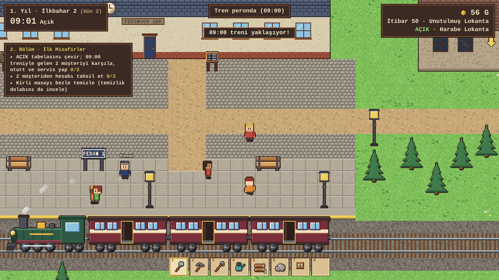

# Son Peron: Miras Lokantası

Tek oyunculu, çevrimdışı çalışan, tamamen Türkçe bir HTML5 cozy lokanta oyunu.
**Phaser 3 + modern JavaScript (ES modülleri) + Vite.** Bütün görseller ve sesler proje içinde üretilir;
çalışma zamanında internet, hesap, API anahtarı ya da harici asset gerekmez.

Tasarım girdileri (değiştirilmeden korunur): `Son_Peron_Tam_Surum_GDD_v1_0.md`, `Son_Peron_v1_0_Birlesik_Oyun_Verileri.json`.



## Kurulum ve çalıştırma

```bash
npm install && npm run dev      # http://localhost:5173
npm run build                   # asset üretimi + dist/ paketleme
npm run preview                 # dist/ klasörünü http://localhost:4173 üzerinden sunar
npm test                        # 42 birim/entegrasyon testi (başsız simülasyon)
npm run test:e2e                # gerçek tarayıcı testi (önce npm run build; Playwright + Chromium gerekir)
npm run assets                  # yalnız PNG atlaslarını yeniden üret (deterministik)
```

`dist/` statik dosyalardır; herhangi bir statik sunucudan (GitHub Pages dahil, `base: './'`) çalışır.
ES modülleri nedeniyle `file://` ile çift tıklayarak açılmaz — `npm run preview` kullanın.

## Kontroller

| Tuş | İşlev |
|---|---|
| W A S D / oklar | Yürü (çapraz hareket normalize) |
| Shift | Koş (stamina yok) |
| E / fare tıklaması | Bağlama duyarlı etkileşim (~1,5 karo menzil) |
| F | Seçili aleti kullan |
| 1–8 | Hızlı slot |
| Tab | Çanta |
| B | Mobilya yerleştirme modu — R döndür, sol tık yerleştir/kaldır, sağ tık bırak |
| C | Marangoz tezgâhı (yakınındayken) |
| J / M | Görev defteri / kasaba haritası |
| Q | Taşınan tencere/servisi uygun yere bırak |
| Esc | Duraklat / geri |
| Fare tekerleği | %75–150 yakınlaştırma |
| F11 | Tam ekran |

Bir panel ya da yerleştirme modu açıkken **tek oyun saati durur**: pişirme, müşteri sabrı, tren, tarım ve
personel birlikte bekler.

## Oyun akışı (kısa)

- **Gün 1:** mektup → tozlu sandık (4 alet) → ormandan 15 odun + 5 taş → kapı, tezgâh, ocak onarımı →
  masa + 2 sandalye üret/yerleştir (4 koltuk) → posta kutusundan 44 G'lik ilk sipariş (100 → 56 G) → yatak.
- **Gün 2:** teslimat kutusu → sebze çorbası (4 dk hazırlık + 30 dk pişirme, 4 porsiyon) → tencereyi bara
  taşı, meyve suyunu içecek slotuna koy → AÇIK tabelası → 09:00 treniyle iki misafir → karşıla, masa seç,
  sipariş al, bardan taşı, servis et, hesabı al, masayı sil.
- **Gün 3+:** serbest sandbox. Restorasyon yalnız ödemeli müşteri sayısı + altın + malzemeye bağlıdır; hikâye isteğe bağlıdır.

## Kayıt

- Birincil depo **IndexedDB** (`son-peron` veritabanı). Her sabah ve uykudan sonra otomatik kayıt; Esc menüsünden elle kayıt.
- Esc → **Kaydı Dışa Aktar** tam durumu sürümlü JSON olarak indirir; **Kayıt İçe Aktar** (ana menü ya da Esc) geri yükler.
- Bozuk/yanlış/daha yeni sürümlü dosya oyunu çökertmez; Türkçe hata mesajı gösterilir, mevcut oyun korunur.

## Mimari

```
src/data/        catalog.js (JSON → doğrulanmış katalog), supplement.js (JSON'da olmayan türev tablolar)
src/world/       maps.js (4 haritanın deterministik üretimi), grid.js (A*, erişilebilirlik)
src/systems/     Phaser'sız simülasyon: sim.js (GameClock + GameState + olaylar + işlem günlüğü),
                 inventory, building (yerleştirme/crafting/restorasyon), kitchen (pişirme/bar/parti-tazelik),
                 service (müşteri durum makinesi), trains, staff, quests, farming, town, calendar, daycycle,
                 interact (E yönlendirmesi), save
src/scenes/      BootScene, WorldScene (çizim + girdi; oyun mantığı içermez)
src/ui/          ui.js (HUD + panel çatısı), panels.js (26 panel), storage.js (IndexedDB)
src/art/         px.js, tiles.js, items.js, furniture.js, world.js, chars.js, atlas.js — pixel-art üreticileri
src/audio/       audio.js — Web Audio ile üretilen müzik ve efektler
src/dev/bot.js   oyunu yalnız oyuncu API'siyle oynayan otomatik oyuncu (testler ve e2e)
tools/           generate-assets.mjs, png.mjs (bağımlılıksız PNG kodlayıcı)
tests/           *.test.js (vitest), e2e/run-e2e.mjs (Playwright)
public/assets/   üretilmiş atlas.png + atlas.json + 4 mevsim karo seti
```

- **Tek zaman otoritesi:** `Sim.tick(dakika)`; 1020 oyun dk = 1200 gerçek sn. 23:00'te görünen saat sabitlenir,
  içerideki servis sınırlı (150 oyun dk) kapanış zamanlayıcısıyla çözülür.
- **Atomik işlemler:** ödeme, teslimat, vardiya ücreti, onarım, proje, görev/kozmetik ödülü `sim.once(kimlik)` ile
  bir kez uygulanır; kimlikler kayıtta taşınır.
- **Stok:** her pişirme ayrı `batch`; `kullanılabilir = fiziksel − rezerve`; FIFO; 2 gün (soğutucuyla 4) tazelik.
- **Veriden çalışma:** tarif/mobilya/ekipman/görev/etkinlik kodda adıyla dallanmaz; hepsi katalogdan okunur.
- **Görseller:** 16 px/karo çizilip 2× büyütülen, sabit paletli, tohumlu prosedürel pixel art. Statik sprite'lar
  PNG atlasa yazılır (621 kare); karakter atlasları aynı üreticiyle görünüme göre çalışma zamanında oluşturulur.

## Uzlaştırma ve yorum notları

Öncelik: kilit kullanıcı kararları → GDD §29 / JSON `canonical` → v0.9 → v0.8 → v0.7.

| Konu | Uygulanan çözüm |
|---|---|
| Tren tarifesi (v1.1) | Kullanıcı kararıyla günde **5 sefer: 09:00 · 12:00 · 15:00 · 18:00 · 21:00** (GDD/JSON'da 3 sefer). Tarife `supplement.js` → `TRAIN_SCHEDULE`. 09/15/21 ziyaretçi aralıkları GDD'deki gibi; 12:00 ve 18:00 daha küçük dalga getirir. Özel etkinlikler hâlâ 09/15/21 seferlerini güçlendirir. Eski 3 seferli kayıtlar yüklenince o günün tarifesi tamamlanır. |
| `salon_expansion_3` | Teknik ID korunur; **doğu mutfak kanadını** açar, oyuncuya kanat adı gösterilir. |
| Komşu oda dikdörtgenleri | JSON dikdörtgenleri zemin kabul edildi; bitişik kanatlarda 1 karoluk taşıyıcı duvar kanadın içinden ayrıldı (ör. kuzey salonu x 19–29). |
| Restoran girişi (54,45) | Kapı hücresi binanın içine (54,44) oyuldu; (54,45) kapı önüdür. |
| Müşteri profilleri, ziyaretçi aralıkları, sabır | GDD §16–17 metninden `supplement.js`'e alındı (JSON'da yok). |
| İsteğe bağlı renovasyon etkileri | GDD yalnız maliyet verir. Dış cephe: ortam +6, ilgi +%5 · Mutfak: depo +16 · Depo: doğu depo odası + 24 slot · Gar tabelası: ilgi +%10 · Teras: ortam +8 ve ön bahçe bankları. |
| Perde 1×2, duvar kâğıdı 1×4 | Perde tek duvar hücresi kaplar (görsel 2 karo); duvar kâğıdı yatay 4 duvar hücresi kaplar. |
| Sandık/raf | Ayrı envanter değil, ortak depo havuzuna slot ekler (GDD §10). |
| Tutorial treni | "Gün 2"ye değil, `story_04` aktifken ilk 09:00 trenine bağlandı; oyuncu 1. günü bitiremezse kilit oluşmaz. Hazırlık bitmezse saat 08:45'te bekler, tren yine 09:00'da gelir. |
| Rana'nın ziyaret günleri | Her 7 günün 5. günü; ilgili görev aktifken her gün 15:00 treninden sonra gar meydanında. |
| Festival hedefleri | GDD yalnız "odak" verir; günlük servis hedefleri `FESTIVAL_GOALS` içinde tanımlandı. Kozmetik zaten varsa 60 G verilir. |
| Hikâye tarif ödülleri | story_06/11/13 belirli tariflerin yalnız **müşteri eşiğini** erken karşılar; aşama ve kurulu ekipman şartı kalır. |

## Bilinen eksikler / sınırlar

Dürüst liste `TEST_REPORT.md` içinde "Doğrulanamayan ve eksik kalanlar" başlığındadır.
