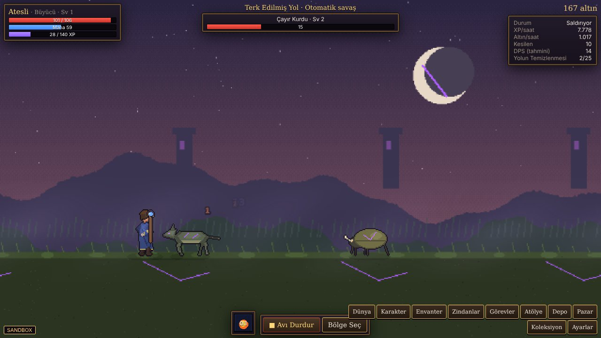

# VARNETH: The Endless Hunt — Alpha 0.1 "The First Hunt"

Sinematik karanlık fantastik pixel art **otomatik grind RPG**. HTML5 (Phaser 3.90 + Vite), sunucu otoriteli ilerleme,
gerçek oyuncular arası pazar (Supabase/PostgreSQL).



## Hızlı başlangıç

```bash
npm install
npm run dev            # http://localhost:5173 — Supabase/yerel sunucu yoksa Sandbox modu açılır
npm run build          # dist/
npm run test           # birim + PostgreSQL entegrasyon testleri (PostgreSQL yoksa DB testleri atlanır)
npm run package:itch   # release/varneth-itch.zip (index.html kökte, göreli yollar)
npm run balance        # grafik çizmeden binlerce sanal savaş: DPS, XP/saat, ölüm oranı, boss/zindan kazanma oranı
npm run assets         # tüm pixel art'ı Python/Pillow ile yeniden üretir (public/assets)
npm run server         # yerel çok kullanıcılı oyun sunucusu (PostgreSQL gerekir)
npm run build:edge     # Supabase Edge Function paketini hazırlar
```

## Bağlantı modları

| Mod | Ne zaman | Pazar |
|---|---|---|
| **Çevrimiçi** | `.env` içinde `VITE_SUPABASE_URL` + `VITE_SUPABASE_PUBLISHABLE_KEY` | Gerçek oyuncu pazarı |
| **Yerel Sunucu** | `VITE_LOCAL_SERVER_URL` + `npm run server` | Gerçek (iki hesap / iki tarayıcı) |
| **Sandbox** | Her zaman; tarayıcı içi PostgreSQL (PGlite) | **Kapalı** — sahte ilan yok, veriler canlı ekonomiye aktarılmaz |

Kurulum: [docs/DATABASE_SETUP.md](DATABASE_SETUP.md) · Dağıtım: [docs/DEPLOYMENT.md](DEPLOYMENT.md) ·
Tasarım: [docs/GAME_DESIGN.md](GAME_DESIGN.md) · Testler: [docs/TEST_REPORT.md](TEST_REPORT.md)

## Mimari

```
shared/                 # istemci + sunucu ortak, saf JS (Deno/Node/tarayıcı)
  data/                 # veri tabloları: sınıflar, yetenekler, ağaçlar, düşmanlar, bölgeler, eşyalar, affix, tarif, görev
  formulas.js stats.js  # merkezi savaş/ekonomi formülleri + üst sınırlar
  loot.js               # prosedürel ganimet, affix, reforge/polish
  combat/sim.js         # deterministik sabit adımlı (50 ms) savaş simülasyonu + yapay zekâ durum makinesi
  server/commands.js    # GÜVENİLİR komut katmanı: her altın/eşya/XP değişimi tek PostgreSQL transaction'ı
src/                    # Phaser sahnesi (görsel sunum), DOM arayüz, ses, backend bağlayıcıları
server/                 # yerel Node sunucusu, migration çalıştırıcı
supabase/               # migration'lar (şema + RLS), Edge Function `game`
tools/                  # asset üretici (Python/Pillow), denge simülatörü, paketleme
tests/                  # vitest: birim + PostgreSQL entegrasyon + HTTP uçtan uca
```

**Sunucu otoritesi:** Savaş, aynı deterministik simülasyonla hem istemcide (görsel) hem sunucuda (yetkili) çalışır.
Sunucu, oturum seed'ini ve karakter statlarını kendisi belirler; her ~20 sn'lik heartbeat'te **kendi saatine göre** geçen
tick sayısını simüle eder, ödülleri yazar ve istemcinin simülasyonunu kendi anlık görüntüsüyle yeniden eşitler.
İstemci "ödül kazandım" diyemez; FPS, sekme hilesi veya cihaz saati ödülü artıramaz. Heartbeat gelmezse 90 sn'lik
kiralama süresi biter ve offline kurallarına geçilir.

## Lisans / varlıklar

Tüm sprite, arka plan, ikon, efekt, logo ve müzik/sesler bu proje için **prosedürel olarak üretilmiştir**
(`tools/generate-assets/`, `src/game/audio.js`). Harici telifli varlık kullanılmamıştır. Kod bağımlılıkları:
Phaser (MIT), PGlite (Apache-2.0/PostgreSQL), supabase-js (MIT), Vite/Vitest (MIT), pg (MIT).
